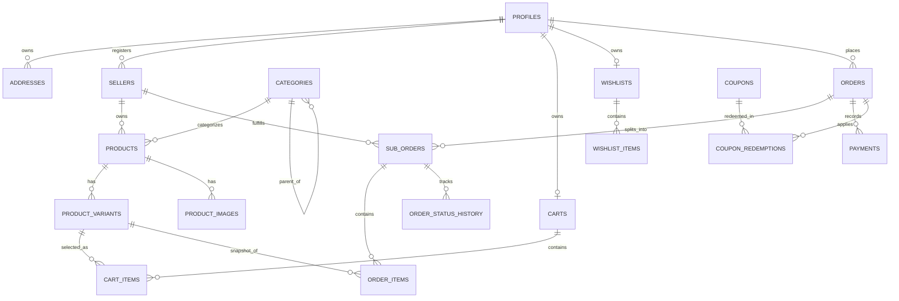

# QuickSure – System Architecture & Technical Boundaries

**Document Version:** 1.0.0  
**Status:** ARCHITECTURAL CONTRACT  
**Rule:** Any code written must strictly adhere to the boundaries defined herein.

---

## 1. System Topology & Decoupled Three-Tier Model

QuickSure enforces a strict three-tier architecture where the frontend application is completely decoupled from the persistence layer.

```
┌─────────────────────────────────────────────────────────────┐
│                    TIER 1: FRONTEND CLIENT                  │
│                     (React 19 + Vite SPA)                   │
│   Storefront (Buyer)  │  Seller Portal  │  Admin Portal     │
└──────────────────────────────┬──────────────────────────────┘
                               │ HTTPS + Bearer JWT
                               ▼
┌─────────────────────────────────────────────────────────────┐
│                     TIER 2: API GATEWAY                     │
│                    (Node.js + Express API)                  │
│  - JWT Verification & Role-Based Access Control (RBAC)      │
│  - Zod Request Validation & Sanitization                    │
│  - Server-Authoritative Price, Tax, Discount & Shipping Calc│
│  - Atomic Concurrency Inventory Reservation Engine          │
│  - Multi-Seller Sub-Order Splitting Machine                 │
│  - Mock Payment & Delivery Simulation Engine                │
└──────────────────────────────┬──────────────────────────────┘
                               │ Service Role / Parameterized SQL
                               ▼
┌─────────────────────────────────────────────────────────────┐
│                TIER 3: DATA & PLATFORM SERVICES             │
│                       (Supabase Cloud)                      │
│   PostgreSQL 15 (17 Relational Tables + RLS + Triggers)     │
│   Supabase Auth (Identity, Passwords, Google OAuth, JWT)    │
│   Supabase Storage (CDN Buckets for Product Media)          │
└─────────────────────────────────────────────────────────────┘
```

### 1.1 Non-Negotiable Boundary Rules
1. **Zero Direct Database Access from Frontend:**  
   The React application holds ONLY `VITE_SUPABASE_ANON_KEY` for authentication session management. All catalog queries, cart mutations, checkout sequences, and dashboard management calls MUST route through the Express API.
2. **Service Role Isolation:**  
   `SUPABASE_SERVICE_ROLE_KEY` is strictly confined to the Express server environment. It must never be bundled into the client bundle or exposed via any API response.
3. **Server-Authoritative Pricing:**  
   Prices, taxes, delivery fees, and discount totals calculated on the frontend are purely decorative display values. The Express API re-fetches authoritative product variant prices from PostgreSQL during checkout and executes all monetary math.

---

## 2. Key Architecture Decision Records (ADRs)

- **ADR-001 (Strict API Gateway):** All business logic, cart merges, pricing calculations, and order creation reside in Express. Eliminates RLS security holes and client price tampering.
- **ADR-002 (Parent-Child Order Splitting):** Single checkout split into 1 parent `orders` record (customer total & payment) and multiple `sub_orders` partitioned by `seller_id`. Ensures seller isolation and independent courier tracking numbers.
- **ADR-003 (Normalized `product_variants` Table):** Products are decoupled into parent metadata (`products`) and individual SKUs (`product_variants`) with price, compare-at-price, and stock. Enables atomic SQL locking.
- **ADR-004 (Atomic SQL Concurrency Control):** Stock reduction is executed via atomic conditional updates:
  ```sql
  UPDATE product_variants
  SET stock_quantity = stock_quantity - $qty
  WHERE id = $variant_id AND stock_quantity >= $qty
  RETURNING id, stock_quantity;
  ```
  If zero rows are updated, the checkout aborts with HTTP 409 Conflict.
- **ADR-005 (Hybrid Cart):** Guest items in `localStorage`; authenticated items in database `carts` and `cart_items`. Auto-merged via `POST /api/cart/merge` upon authentication.

---

## 3. Database Schema Blueprint (17 Tables)



1. **`profiles`:** User metadata (`id (UUID PK -> auth.users)`, `email`, `full_name`, `avatar_url`, `phone`, `role ('customer'|'seller'|'admin')`, `is_active`).
2. **`addresses`:** User address book (`id`, `user_id`, `recipient_name`, `phone`, `street_address`, `apartment`, `city`, `state`, `postal_code`, `country`, `is_default`).
3. **`sellers`:** Store profiles (`id`, `user_id`, `store_name`, `store_slug`, `description`, `logo_url`, `banner_url`, `commission_rate`, `status ('pending'|'approved'|'suspended'|'rejected')`).
4. **`categories`:** Taxonomy (`id`, `name`, `slug`, `description`, `icon_url`, `parent_id`, `is_active`, `display_order`).
5. **`products`:** Parent catalog (`id`, `seller_id`, `category_id`, `title`, `slug`, `brand`, `description`, `specifications (JSONB)`, `is_active`, `is_approved`, `rating_avg`, `rating_count`, `deleted_at`).
6. **`product_variants`:** SKUs (`id`, `product_id`, `sku`, `variant_name`, `price`, `compare_at_price`, `stock_quantity`, `attributes (JSONB)`, `is_active`).
7. **`product_images`:** Photos (`id`, `product_id`, `image_url`, `alt_text`, `is_primary`, `display_order`).
8. **`carts`:** User cart container (`id`, `user_id`).
9. **`cart_items`:** Line items (`id`, `cart_id`, `variant_id`, `quantity`).
10. **`wishlists` & `wishlist_items`:** Favorites (`wishlists`: `id`, `user_id`; `wishlist_items`: `id`, `wishlist_id`, `product_id`).
11. **`orders`:** Parent checkout (`id`, `order_number`, `user_id`, `status`, `subtotal`, `discount_amount`, `shipping_fee`, `tax_amount`, `total_amount`, `shipping_address (JSONB)`, `payment_method`, `payment_status`, `idempotency_key`).
12. **`sub_orders`:** Seller shipments (`id`, `sub_order_number`, `order_id`, `seller_id`, `status`, `subtotal`, `seller_payout_amount`, `commission_fee`, `courier_name`, `tracking_number`, `shipped_at`, `delivered_at`).
13. **`order_items`:** Snapshot line items (`id`, `sub_order_id`, `variant_id`, `product_title`, `variant_name`, `sku`, `unit_price`, `quantity`, `total_price`).
14. **`payments`:** Simulation audit (`id`, `order_id`, `transaction_ref`, `payment_method`, `amount`, `status`, `raw_payload (JSONB)`).
15. **`order_status_history`:** Audit timeline (`id`, `sub_order_id`, `from_status`, `to_status`, `changed_by_user_id`, `notes`).
16. **`coupons`:** Campaign rules (`id`, `code`, `discount_type`, `discount_value`, `min_order_amount`, `max_discount_amount`, `usage_limit`, `times_used`, `starts_at`, `expires_at`, `is_active`).
17. **`coupon_redemptions`:** Single-use tracker (`id`, `coupon_id`, `user_id`, `order_id`, `discount_amount`, `redeemed_at`).

---

## 4. Multi-Seller Fulfillment Pipeline

```
Customer Cart (Variant A from Seller 1, Variant B from Seller 2)
                           │
                           ▼
          POST /api/orders/checkout (Idempotency Key)
                           │
         ┌─────────────────┴─────────────────┐
         ▼                                   ▼
[Deduct Stock Variant A]            [Deduct Stock Variant B]
         │                                   │
         └─────────────────┬─────────────────┘
                           ▼
           Insert Parent Order (Total $150)
                           │
         ┌─────────────────┴─────────────────┐
         ▼                                   ▼
Insert Sub-Order 1 (Seller 1)       Insert Sub-Order 2 (Seller 2)
- Items: Variant A                  - Items: Variant B
- Status: 'pending'                 - Status: 'pending'
- Courier: null                     - Courier: null
         │                                   │
         ▼                                   ▼
Seller 1 Portal: Dispatches         Seller 2 Portal: Dispatches
- Updates status to 'shipped'       - Updates status to 'shipped'
- Sets Tracking: DELHIVERY-123      - Sets Tracking: BLUEDART-456
```

---

## 5. Security & Isolation Architecture

1. **Role Enforcement:** Three mutually exclusive roles (`customer`, `seller`, `admin`). Endpoints are secured via `requireAuth` and `requireRole(...)`.
2. **Horizontal Privilege Isolation (IDOR):**
   - Customer queries scoped by `WHERE user_id = req.user.id`.
   - Seller queries scoped by `WHERE seller_id = req.seller.id`.
   - Admin queries unconstrained but require verified `admin` role.
3. **Database Constraints:** Foreign keys strictly use `ON DELETE RESTRICT` for financial and order tables to preserve audit records. Soft-delete timestamps (`deleted_at`) protect catalog continuity.
