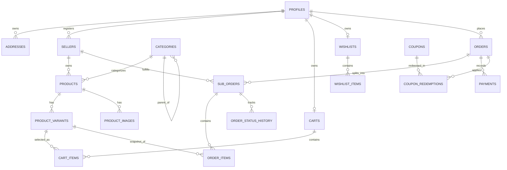

# QuickSure – Comprehensive System Architecture Specification

**Status:** APPROVED ARCHITECTURAL SPECIFICATION  
**Author:** Senior Software Architect, Security Auditor & Database Architect  
**Project:** QuickSure – Multi-Category Multi-Seller E-Commerce Marketplace  
**Revision Date:** 2026-11-20  

---

## 1. Architectural Principles & System Topography

### 1.1 Strict Three-Tier Decoupled Architecture

```
┌─────────────────────────────────────────────────────────────┐
│                    TIER 1: FRONTEND CLIENT                  │
│                     (React 19 + Vite SPA)                   │
│   Storefront (Buyer)  │  Seller Portal  │  Admin Portal     │
└──────────────────────────────┬──────────────────────────────┘
                               │ HTTPS + Bearer JWT
                               ▼
┌─────────────────────────────────────────────────────────────┐
│                     TIER 2: API GATEWAY                     │
│                    (Node.js + Express API)                  │
│  - JWT Verification & Role-Based Access Control (RBAC)      │
│  - Zod Request Validation & Sanitization                    │
│  - Server-Authoritative Price, Tax, Discount & Shipping Calc│
│  - Atomic Concurrency Inventory Reservation Engine          │
│  - Multi-Seller Sub-Order Splitting Machine                 │
│  - Mock Payment & Delivery Simulation Engine                │
└──────────────────────────────┬──────────────────────────────┘
                               │ Service Role / Parameterized SQL
                               ▼
┌─────────────────────────────────────────────────────────────┐
│                TIER 3: DATA & PLATFORM SERVICES             │
│                       (Supabase Cloud)                      │
│   PostgreSQL 15 (17 Relational Tables + RLS + Triggers)     │
│   Supabase Auth (Identity, Passwords, Google OAuth, JWT)    │
│   Supabase Storage (CDN Buckets for Product Media)          │
└─────────────────────────────────────────────────────────────┘
```

#### The Golden Architectural Rule:
> **Zero Direct Database Access from Frontend.**  
> The React client possesses **only** the `SUPABASE_ANON_KEY` for client-side Auth session management. All CRUD operations, catalog queries, cart mutations, checkout sequences, and administrative actions must route exclusively through the **Node.js Express API**.  
> The Express backend holds the privileged `SUPABASE_SERVICE_ROLE_KEY` (never exposed to browser bundles) and acts as the gatekeeper enforcing business validation, tenant isolation, and atomic state updates.

---

## 2. Architecture Decision Records (ADRs)

### ADR-001: Strict Three-Tier API Gateway vs. Direct Supabase Client
- **Status:** Accepted
- **Context:** Supabase allows clients to query PostgreSQL directly via PostgREST and Row Level Security (RLS). However, e-commerce marketplaces require complex multi-step workflows: coupon validation, tax and shipping calculation, inventory reservation across multiple items, seller commission deduction, and multi-seller sub-order creation.
- **Decision:** All business operations are mediated by Express REST API services. The client never queries PostgreSQL directly.
- **Trade-offs:** Additional network hop (Client ➔ Express ➔ Supabase), but provides centralized business logic, tamper-proof pricing, and prevents RLS misconfiguration leaks.

### ADR-002: Parent-Child Order Splitting for Multi-Seller Marketplace
- **Status:** Accepted
- **Context:** Customers place a single checkout for items originating from multiple distinct sellers. Sellers cannot fulfill or view other sellers' shipments.
- **Decision:** Split orders into one `orders` record (representing the customer's financial payment and delivery address) and multiple `sub_orders` (each tied to a specific `seller_id`, having its own fulfillment status, shipping cost, and tracking number).
- **Trade-offs:** Requires an atomic database transaction at checkout to write parent and child orders simultaneously. Eliminates multi-seller fulfillment race conditions.

### ADR-003: Normalized `product_variants` vs. Denormalized JSONB Matrix
- **Status:** Accepted
- **Context:** Products have multiple dimensions (Size, Color, Material). Storing variants inside a single `products.metadata (jsonb)` column makes concurrent inventory decrements error-prone.
- **Decision:** Adopt a 1-to-many relationship: `products` 1 ── * `product_variants`. Each variant has its own `id`, `sku`, `price`, `stock_quantity`, and JSONB attributes for flexible key-value descriptors (`{"color": "Midnight Blue", "size": "XL"}`).
- **Trade-offs:** Requires joining two tables when querying catalog items, but enables standard, atomic SQL locking (`WHERE id = variant_id AND stock_quantity >= qty`).

### ADR-004: Atomic SQL Concurrency Control for Inventory Reservation
- **Status:** Accepted
- **Context:** High-demand items can be checked out by multiple customers simultaneously, risking stock overselling.
- **Decision:** Inventory reduction is executed via atomic conditional SQL queries inside an Express transaction block:
  ```sql
  UPDATE product_variants
  SET stock_quantity = stock_quantity - $qty
  WHERE id = $variant_id AND stock_quantity >= $qty
  RETURNING id, stock_quantity;
  ```
  If any row returns zero updated rows, the entire order transaction is rolled back, and the client receives HTTP 409 Conflict.
- **Trade-offs:** Rejects checkouts when stock is exhausted instead of backordering; ideal for marketplace reliability.

### ADR-005: Hybrid Dual-State Shopping Cart
- **Status:** Accepted
- **Context:** Guests must be able to browse and add items to a cart without logging in. Once authenticated, their cart must persist across devices.
- **Decision:** Unauthenticated users store cart items in browser `localStorage`. Upon login/registration, an API endpoint `POST /api/cart/merge` merges local guest items into the customer's database `carts` and `cart_items` records, resolving duplicate SKUs.

---

## 3. Complete Database Schema Specification (17 Tables)



### Table 1: `profiles`
User identity metadata linked to Supabase Auth.
- `id` (UUID, PK, references `auth.users(id)` ON DELETE CASCADE)
- `email` (VARCHAR(255), UNIQUE, NOT NULL)
- `full_name` (VARCHAR(150), NOT NULL)
- `avatar_url` (TEXT)
- `phone` (VARCHAR(25))
- `role` (VARCHAR(20), NOT NULL, DEFAULT 'customer', CHECK: `role IN ('customer', 'seller', 'admin')`)
- `is_active` (BOOLEAN, NOT NULL, DEFAULT TRUE)
- `created_at` (TIMESTAMPTZ, NOT NULL, DEFAULT NOW())
- `updated_at` (TIMESTAMPTZ, NOT NULL, DEFAULT NOW())

### Table 2: `addresses`
Shipping and billing address book.
- `id` (UUID, PK, DEFAULT gen_random_uuid())
- `user_id` (UUID, NOT NULL, references `profiles(id)` ON DELETE CASCADE)
- `recipient_name` (VARCHAR(150), NOT NULL)
- `phone` (VARCHAR(25), NOT NULL)
- `street_address` (TEXT, NOT NULL)
- `apartment` (VARCHAR(100))
- `city` (VARCHAR(100), NOT NULL)
- `state` (VARCHAR(100), NOT NULL)
- `postal_code` (VARCHAR(20), NOT NULL)
- `country` (VARCHAR(100), NOT NULL, DEFAULT 'India')
- `is_default` (BOOLEAN, NOT NULL, DEFAULT FALSE)
- `created_at` (TIMESTAMPTZ, NOT NULL, DEFAULT NOW())
- `updated_at` (TIMESTAMPTZ, NOT NULL, DEFAULT NOW())

### Table 3: `sellers`
Store profile for vendors.
- `id` (UUID, PK, DEFAULT gen_random_uuid())
- `user_id` (UUID, UNIQUE, NOT NULL, references `profiles(id)` ON DELETE CASCADE)
- `store_name` (VARCHAR(150), UNIQUE, NOT NULL)
- `store_slug` (VARCHAR(150), UNIQUE, NOT NULL)
- `description` (TEXT)
- `logo_url` (TEXT)
- `banner_url` (TEXT)
- `commission_rate` (NUMERIC(5, 2), NOT NULL, DEFAULT 10.00, CHECK: `commission_rate >= 0`)
- `status` (VARCHAR(20), NOT NULL, DEFAULT 'pending', CHECK: `status IN ('pending', 'approved', 'suspended', 'rejected')`)
- `business_email` (VARCHAR(255), NOT NULL)
- `business_phone` (VARCHAR(25))
- `created_at` (TIMESTAMPTZ, NOT NULL, DEFAULT NOW())
- `updated_at` (TIMESTAMPTZ, NOT NULL, DEFAULT NOW())

### Table 4: `categories`
Hierarchical category tree.
- `id` (UUID, PK, DEFAULT gen_random_uuid())
- `name` (VARCHAR(100), NOT NULL)
- `slug` (VARCHAR(120), UNIQUE, NOT NULL)
- `description` (TEXT)
- `icon_url` (TEXT)
- `parent_id` (UUID, references `categories(id)` ON DELETE SET NULL)
- `is_active` (BOOLEAN, NOT NULL, DEFAULT TRUE)
- `display_order` (INT, NOT NULL, DEFAULT 0)
- `created_at` (TIMESTAMPTZ, NOT NULL, DEFAULT NOW())

### Table 5: `products`
Parent product catalog listing.
- `id` (UUID, PK, DEFAULT gen_random_uuid())
- `seller_id` (UUID, NOT NULL, references `sellers(id)` ON DELETE RESTRICT)
- `category_id` (UUID, NOT NULL, references `categories(id)` ON DELETE RESTRICT)
- `title` (VARCHAR(255), NOT NULL)
- `slug` (VARCHAR(280), UNIQUE, NOT NULL)
- `brand` (VARCHAR(100))
- `description` (TEXT, NOT NULL)
- `specifications` (JSONB, DEFAULT '{}'::jsonb)
- `is_active` (BOOLEAN, NOT NULL, DEFAULT TRUE)
- `is_approved` (BOOLEAN, NOT NULL, DEFAULT FALSE)
- `rating_avg` (NUMERIC(3, 2), NOT NULL, DEFAULT 0.00)
- `rating_count` (INT, NOT NULL, DEFAULT 0)
- `deleted_at` (TIMESTAMPTZ)
- `created_at` (TIMESTAMPTZ, NOT NULL, DEFAULT NOW())
- `updated_at` (TIMESTAMPTZ, NOT NULL, DEFAULT NOW())

### Table 6: `product_variants`
SKUs with stock, attributes, and pricing.
- `id` (UUID, PK, DEFAULT gen_random_uuid())
- `product_id` (UUID, NOT NULL, references `products(id)` ON DELETE CASCADE)
- `sku` (VARCHAR(80), UNIQUE, NOT NULL)
- `variant_name` (VARCHAR(150), NOT NULL)
- `price` (NUMERIC(12, 2), NOT NULL, CHECK: `price >= 0`)
- `compare_at_price` (NUMERIC(12, 2), CHECK: `compare_at_price >= price`)
- `stock_quantity` (INT, NOT NULL, DEFAULT 0, CHECK: `stock_quantity >= 0`)
- `attributes` (JSONB, NOT NULL, DEFAULT '{}'::jsonb)
- `is_active` (BOOLEAN, NOT NULL, DEFAULT TRUE)
- `created_at` (TIMESTAMPTZ, NOT NULL, DEFAULT NOW())
- `updated_at` (TIMESTAMPTZ, NOT NULL, DEFAULT NOW())

### Table 7: `product_images`
Product photo gallery.
- `id` (UUID, PK, DEFAULT gen_random_uuid())
- `product_id` (UUID, NOT NULL, references `products(id)` ON DELETE CASCADE)
- `image_url` (TEXT, NOT NULL)
- `alt_text` (VARCHAR(200))
- `is_primary` (BOOLEAN, NOT NULL, DEFAULT FALSE)
- `display_order` (INT, NOT NULL, DEFAULT 0)
- `created_at` (TIMESTAMPTZ, NOT NULL, DEFAULT NOW())

### Table 8: `carts`
Customer cart container.
- `id` (UUID, PK, DEFAULT gen_random_uuid())
- `user_id` (UUID, UNIQUE, NOT NULL, references `profiles(id)` ON DELETE CASCADE)
- `created_at` (TIMESTAMPTZ, NOT NULL, DEFAULT NOW())
- `updated_at` (TIMESTAMPTZ, NOT NULL, DEFAULT NOW())

### Table 9: `cart_items`
Individual items inside a cart.
- `id` (UUID, PK, DEFAULT gen_random_uuid())
- `cart_id` (UUID, NOT NULL, references `carts(id)` ON DELETE CASCADE)
- `variant_id` (UUID, NOT NULL, references `product_variants(id)` ON DELETE CASCADE)
- `quantity` (INT, NOT NULL, DEFAULT 1, CHECK: `quantity > 0 AND quantity <= 10`)
- `created_at` (TIMESTAMPTZ, NOT NULL, DEFAULT NOW())
- `updated_at` (TIMESTAMPTZ, NOT NULL, DEFAULT NOW())
- UNIQUE(`cart_id`, `variant_id`)

### Table 10: `wishlists` & `wishlist_items`
Saved product favorites.
- `wishlists`: `id` (UUID, PK), `user_id` (UUID, UNIQUE, references `profiles(id)` ON DELETE CASCADE), `created_at`
- `wishlist_items`: `id` (UUID, PK), `wishlist_id` (UUID, references `wishlists(id)` ON DELETE CASCADE), `product_id` (UUID, references `products(id)` ON DELETE CASCADE), `created_at`, UNIQUE(`wishlist_id`, `product_id`)

### Table 11: `orders` (Parent Order)
Overall checkout transaction.
- `id` (UUID, PK, DEFAULT gen_random_uuid())
- `order_number` (VARCHAR(50), UNIQUE, NOT NULL)
- `user_id` (UUID, NOT NULL, references `profiles(id)` ON DELETE RESTRICT)
- `status` (VARCHAR(25), NOT NULL, DEFAULT 'placed', CHECK: `status IN ('placed', 'processing', 'partially_shipped', 'completed', 'cancelled')`)
- `subtotal` (NUMERIC(12, 2), NOT NULL)
- `discount_amount` (NUMERIC(12, 2), NOT NULL, DEFAULT 0.00)
- `shipping_fee` (NUMERIC(12, 2), NOT NULL, DEFAULT 0.00)
- `tax_amount` (NUMERIC(12, 2), NOT NULL, DEFAULT 0.00)
- `total_amount` (NUMERIC(12, 2), NOT NULL)
- `shipping_address` (JSONB, NOT NULL)
- `payment_method` (VARCHAR(30), NOT NULL, CHECK: `payment_method IN ('card_sim', 'upi_sim', 'cod_sim')`)
- `payment_status` (VARCHAR(25), NOT NULL, DEFAULT 'pending', CHECK: `payment_status IN ('pending', 'paid', 'failed', 'refunded')`)
- `idempotency_key` (VARCHAR(100), UNIQUE)
- `created_at` (TIMESTAMPTZ, NOT NULL, DEFAULT NOW())
- `updated_at` (TIMESTAMPTZ, NOT NULL, DEFAULT NOW())

### Table 12: `sub_orders` (Seller-Specific Shipments)
Per-vendor fulfillment partition.
- `id` (UUID, PK, DEFAULT gen_random_uuid())
- `sub_order_number` (VARCHAR(60), UNIQUE, NOT NULL)
- `order_id` (UUID, NOT NULL, references `orders(id)` ON DELETE CASCADE)
- `seller_id` (UUID, NOT NULL, references `sellers(id)` ON DELETE RESTRICT)
- `status` (VARCHAR(25), NOT NULL, DEFAULT 'pending', CHECK: `status IN ('pending', 'confirmed', 'packed', 'shipped', 'delivered', 'cancelled')`)
- `subtotal` (NUMERIC(12, 2), NOT NULL)
- `seller_payout_amount` (NUMERIC(12, 2), NOT NULL)
- `commission_fee` (NUMERIC(12, 2), NOT NULL)
- `courier_name` (VARCHAR(100))
- `tracking_number` (VARCHAR(100))
- `shipped_at` (TIMESTAMPTZ)
- `delivered_at` (TIMESTAMPTZ)
- `created_at` (TIMESTAMPTZ, NOT NULL, DEFAULT NOW())
- `updated_at` (TIMESTAMPTZ, NOT NULL, DEFAULT NOW())

### Table 13: `order_items`
Individual line items inside each sub-order.
- `id` (UUID, PK, DEFAULT gen_random_uuid())
- `sub_order_id` (UUID, NOT NULL, references `sub_orders(id)` ON DELETE CASCADE)
- `variant_id` (UUID, NOT NULL, references `product_variants(id)` ON DELETE RESTRICT)
- `product_title` (VARCHAR(255), NOT NULL)
- `variant_name` (VARCHAR(150), NOT NULL)
- `sku` (VARCHAR(80), NOT NULL)
- `unit_price` (NUMERIC(12, 2), NOT NULL)
- `quantity` (INT, NOT NULL, CHECK: `quantity > 0`)
- `total_price` (NUMERIC(12, 2), NOT NULL)
- `created_at` (TIMESTAMPTZ, NOT NULL, DEFAULT NOW())

### Table 14: `payments`
Simulation transaction log.
- `id` (UUID, PK, DEFAULT gen_random_uuid())
- `order_id` (UUID, NOT NULL, references `orders(id)` ON DELETE RESTRICT)
- `transaction_ref` (VARCHAR(100), UNIQUE, NOT NULL)
- `payment_method` (VARCHAR(30), NOT NULL)
- `amount` (NUMERIC(12, 2), NOT NULL)
- `status` (VARCHAR(20), NOT NULL, CHECK: `status IN ('pending', 'successful', 'failed', 'refunded')`)
- `raw_payload` (JSONB, DEFAULT '{}'::jsonb)
- `created_at` (TIMESTAMPTZ, NOT NULL, DEFAULT NOW())

### Table 15: `order_status_history`
Timestamped audit trail of status progressions.
- `id` (UUID, PK, DEFAULT gen_random_uuid())
- `sub_order_id` (UUID, NOT NULL, references `sub_orders(id)` ON DELETE CASCADE)
- `from_status` (VARCHAR(25))
- `to_status` (VARCHAR(25), NOT NULL)
- `changed_by_user_id` (UUID, references `profiles(id)` ON DELETE SET NULL)
- `notes` (TEXT)
- `created_at` (TIMESTAMPTZ, NOT NULL, DEFAULT NOW())

### Table 16: `coupons`
Discount codes and campaign rules.
- `id` (UUID, PK, DEFAULT gen_random_uuid())
- `code` (VARCHAR(40), UNIQUE, NOT NULL)
- `discount_type` (VARCHAR(20), NOT NULL, CHECK: `discount_type IN ('percentage', 'fixed')`)
- `discount_value` (NUMERIC(10, 2), NOT NULL, CHECK: `discount_value > 0`)
- `min_order_amount` (NUMERIC(10, 2), NOT NULL, DEFAULT 0.00)
- `max_discount_amount` (NUMERIC(10, 2))
- `usage_limit` (INT)
- `times_used` (INT, NOT NULL, DEFAULT 0)
- `starts_at` (TIMESTAMPTZ, NOT NULL, DEFAULT NOW())
- `expires_at` (TIMESTAMPTZ, NOT NULL)
- `is_active` (BOOLEAN, NOT NULL, DEFAULT TRUE)
- `created_at` (TIMESTAMPTZ, NOT NULL, DEFAULT NOW())

### Table 17: `coupon_redemptions`
Enforces single-use rules per customer.
- `id` (UUID, PK, DEFAULT gen_random_uuid())
- `coupon_id` (UUID, NOT NULL, references `coupons(id)` ON DELETE RESTRICT)
- `user_id` (UUID, NOT NULL, references `profiles(id)` ON DELETE CASCADE)
- `order_id` (UUID, NOT NULL, references `orders(id)` ON DELETE CASCADE)
- `discount_amount` (NUMERIC(10, 2), NOT NULL)
- `redeemed_at` (TIMESTAMPTZ, NOT NULL, DEFAULT NOW())
- UNIQUE(`coupon_id`, `user_id`)

---

## 4. REST API Endpoint Specifications

All endpoints return uniform response envelopes:
```json
{
  "success": true,
  "message": "Operation completed successfully",
  "data": {},
  "meta": {}
}
```

### 4.1 Authentication & Profile (`/api/auth`)
- `GET /api/auth/me`: Verifies Bearer JWT, returns `{ profile, seller_profile? }`.
- `POST /api/auth/sync-profile`: Syncs session metadata post-signup.
- `PUT /api/auth/profile`: Updates name, phone, avatar. Role cannot be updated here.

### 4.2 Product Catalog (`/api/products`)
- `GET /api/products`: Public. Query params: `page`, `limit`, `category`, `min_price`, `max_price`, `sort`, `search`. Returns items with primary image, category, seller name, price range.
- `GET /api/products/:slug`: Public. Complete product details, full variant list with stock, image gallery, seller info.
- `POST /api/products`: Seller only. Creates product and initial variants/images.
- `PUT /api/products/:id`: Seller/Admin. Updates product title, description, category.
- `DELETE /api/products/:id`: Seller/Admin. Soft delete (`deleted_at = NOW()`).

### 4.3 Categories (`/api/categories`)
- `GET /api/categories`: Public. Returns hierarchical category tree.
- `POST /api/categories`: Admin only. Creates category.
- `PUT /api/categories/:id`: Admin only. Updates category.

### 4.4 Shopping Cart (`/api/cart`)
- `GET /api/cart`: Customer. Returns user's cart items with live variant prices and stock status.
- `POST /api/cart/items`: Customer. Body: `{ variant_id, quantity }`. Adds/updates item.
- `DELETE /api/cart/items/:id`: Customer. Removes item.
- `POST /api/cart/merge`: Customer. Body: `{ items: [{ variant_id, quantity }] }`. Merges guest localStorage cart into database cart on login.

### 4.5 Checkout & Orders (`/api/orders`)
- `POST /api/orders/quote`: Customer. Body: `{ shipping_address_id, coupon_code }`. Validates stock, calculates subtotal, coupon discount, shipping fee, tax, and returns order preview.
- `POST /api/orders/checkout`: Customer. Header: `Idempotency-Key`. Body: `{ shipping_address_id, payment_method, coupon_code }`.
  1. Atomically locks and decrements stock.
  2. Inserts parent `orders` record.
  3. Splits and inserts `sub_orders` per seller.
  4. Inserts `order_items` snapshots.
  5. Records coupon redemption if applicable.
  6. Clears customer cart.
- `GET /api/orders`: Customer. Returns customer's parent orders list.
- `GET /api/orders/:id`: Customer/Admin. Returns parent order details with sub-orders and tracking numbers.
- `POST /api/orders/:id/cancel`: Customer/Admin. Cancels order if still in `placed` state; restores inventory stock atomically.

### 4.6 Payment Simulation (`/api/payments`)
- `POST /api/payments/simulate`: Customer/System. Body: `{ order_id, scenario: 'success' | 'failure' }`. Updates payment and order status, records `payments` log.

### 4.7 Seller Portal (`/api/seller`)
- `GET /api/seller/profile`: Seller. Returns store settings and status.
- `POST /api/seller/register`: Authenticated user. Submits seller application.
- `GET /api/seller/orders`: Seller. Returns only `sub_orders` belonging to this seller.
- `PUT /api/seller/orders/:sub_order_id/status`: Seller. Updates status (`confirmed` ➔ `packed` ➔ `shipped` with `courier_name` and `tracking_number`).
- `GET /api/seller/inventory`: Seller. List of variants with stock adjustment endpoint `PUT /api/seller/inventory/:variant_id`.

### 4.8 Admin Portal (`/api/admin`)
- `GET /api/admin/metrics`: Admin. Platform metrics: GMV, total orders, active sellers, product counts.
- `GET /api/admin/sellers`: Admin. List sellers with status filter.
- `PUT /api/admin/sellers/:id/status`: Admin. Approve or suspend seller.
- `PUT /api/admin/products/:id/approve`: Admin. Approve product listing for storefront visibility.
- `POST /api/admin/coupons`: Admin. Create new coupon campaigns.

---

## 5. Security & Isolation Controls

1. **Service Role Isolation:** The backend Express server connects to Supabase using `SUPABASE_SERVICE_ROLE_KEY`, but binds all database operations strictly to authenticated JWT `req.user.id` or explicit role verifications.
2. **Immutable Role Claims:** User roles are queried from `profiles.role` using server-side caching or custom claims and verified on every protected route via `requireRole('admin')` or `requireRole('seller')`.
3. **IDOR Prevention:**
   - Customers can only query orders where `orders.user_id = req.user.id`.
   - Sellers can only query sub-orders where `sub_orders.seller_id = req.seller.id`.
4. **Input Sanitization:** Every mutating endpoint runs Zod schema validation to strip extra fields and reject malformed types before reaching the database layer.
