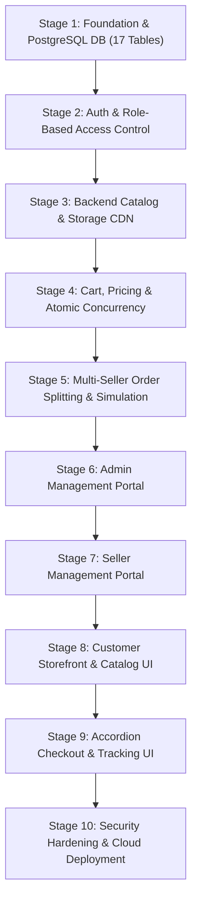

# QuickSure – Phased Implementation Roadmap & Verification Gates

**Status:** ACTIVE STAGE DIRECTIVE  
**Rule:** Work must proceed sequentially through these stages. Moving to the next stage requires passing the prior stage's verification gate.

---

## Stage-by-Stage Implementation Matrix

---

### Stage 1: Foundation & Database Architecture
- **Objective:** Establish monorepo workspace, Express REST server skeleton, Supabase client initialization, and apply PostgreSQL migrations for all 17 normalized tables.
- **Tasks:**
  1. Initialize root workspace with npm workspaces (`client`, `server`) and shared scripts.
  2. Setup Express server with CORS, Helmet, Morgan, and standardized API response utilities.
  3. Author and apply PostgreSQL SQL migrations creating the 17 tables with foreign keys, constraints, and B-tree indexes.
  4. Write seed data with demo categories, sellers, products, variants, and coupon codes.
- **Exit Verification Gate:**
  - `GET /api/health` returns HTTP 200 with database latency < 100ms.
  - SQL verification script executes without error; all 17 tables verified with correct constraints.

---

### Stage 2: Authentication & Role-Based Access Control
- **Objective:** Integrate Supabase Auth, build automatic `profiles` provisioning triggers, and establish Express JWT verification middleware.
- **Tasks:**
  1. Configure Supabase Auth client in React and Supabase Admin SDK in Express.
  2. Create PostgreSQL trigger on `auth.users` to automatically insert `profiles` with default role `customer`.
  3. Implement Express middlewares: `requireAuth`, `requireRole('admin')`, `requireRole('seller')`.
  4. Build `/api/auth/me` and `/api/auth/profile` endpoints.
- **Exit Verification Gate:**
  - Customer registration automatically generates a `profiles` row.
  - Express API validates Bearer JWT and rejects expired or spoofed tokens with HTTP 401.
  - Role escalation tests confirm customers cannot access protected admin/seller endpoints.

---

### Stage 3: Backend Catalog & Storage CDN
- **Objective:** Build robust REST APIs for categories, products, variants, and image uploads.
- **Tasks:**
  1. Build `/api/categories` with hierarchical parent-child support.
  2. Build `/api/products` (faceted filtering: category, price bounds, brand, ratings; sorting; pagination).
  3. Build `/api/products/:slug` with full variant matrix and image relations.
  4. Setup Supabase Storage bucket `product-images` with validated upload middleware (MIME whitelist, 5MB limit).
- **Exit Verification Gate:**
  - Filter and search queries execute in a single SQL round-trip with correct pagination metadata.
  - Product images are served via public CDN URLs.

---

### Stage 4: Shopping Cart, Pricing & Atomic Concurrency
- **Objective:** Build persistent cart management, guest cart merge, server-authoritative pricing calculations, and atomic inventory controls.
- **Tasks:**
  1. Build `/api/cart` endpoints (get cart, add/update item, remove item).
  2. Implement `POST /api/cart/merge` for merging guest `localStorage` items upon login.
  3. Build Pricing Service: Calculates subtotal, shipping fee, tax, and validates coupon codes.
  4. Implement atomic inventory reservation check.
- **Exit Verification Gate:**
  - Parallel requests for the last remaining stock unit result in exactly one success and one HTTP 409 Conflict (zero overselling).
  - Manipulated client cart prices are completely ignored by the server pricing engine.

---

### Stage 5: Multi-Seller Order Splitting & Simulation Services
- **Objective:** Implement checkout transaction splitting orders into seller-specific sub-orders, payment simulation, and order status transitions.
- **Tasks:**
  1. Build `POST /api/orders/checkout` requiring `Idempotency-Key`.
  2. Implement atomic order creation: Parent `orders` + seller `sub_orders` + line `order_items`.
  3. Build Payment Simulator: `POST /api/payments/simulate` with success, decline, and timeout scenarios.
  4. Log all state changes to `order_status_history`.
- **Exit Verification Gate:**
  - Multi-seller cart checkouts produce distinct sub-orders partitioned by seller.
  - Idempotent retries return the original order without creating duplicate database rows.

---

### Stage 6: Admin Management Portal
- **Objective:** Build the administrative control portal for platform oversight.
- **Tasks:**
  1. Admin layout shell with protected routes.
  2. Dashboard metrics: Gross Merchandise Value (GMV), total orders, active sellers.
  3. Seller moderation: Review and approve/suspend seller stores.
  4. Catalog moderation: Approve or deactivate seller product listings.
  5. Coupon management: Create and monitor promotional discount codes.
- **Exit Verification Gate:**
  - Unapproved seller products are confirmed invisible on the public storefront.
  - Admin metrics reflect real-time database totals.

---

### Stage 7: Seller Management Portal
- **Objective:** Build vendor workspace for catalog, stock, and order fulfillment.
- **Tasks:**
  1. Seller onboarding application flow (`/seller/register`).
  2. Product & variant inventory editor with image upload.
  3. Sub-order fulfillment workflow: update status (`confirmed` ➔ `packed` ➔ `shipped`) and assign tracking number.
  4. Financial overview: Gross sales, commission deductions, and net payout ledger.
- **Exit Verification Gate:**
  - Sellers can only view and mutate their own products and sub-orders (Zero IDOR).
  - Marking a sub-order as shipped updates the status and appends a record to `order_status_history`.

---

### Stage 8: Customer Storefront & Catalog UI
- **Objective:** Build the customer-facing e-commerce shopping experience.
- **Tasks:**
  1. Design system implementation: Navbar, Mega-menu, Search bar, Footer, Cart badge.
  2. Homepage: Banner carousel, category cards, featured products, trust badges.
  3. Product Listing Page (PLP): Faceted filter sidebar, sorting, pagination, grid/list view.
  4. Product Detail Page (PDP): Multi-image zoom gallery, variant selector, dynamic stock badge, customer reviews.
- **Exit Verification Gate:**
  - All views responsive on mobile (375px), tablet (768px), and desktop.
  - Zero layout shifts (CLS < 0.1) during pagination and filtering.

---

### Stage 9: Checkout & Account Interfaces
- **Objective:** Build checkout wizard, order confirmation, and customer account portal.
- **Tasks:**
  1. Accordion-style Single-Page Checkout (Address -> Shipping -> Payment -> Confirm).
  2. Payment simulation modal with instant feedback.
  3. Order Confirmation & Tracking visualizer showing sub-order shipment progress.
  4. Customer Account views: Profile, saved addresses, order history, and downloadable invoices.
- **Exit Verification Gate:**
  - Complete end-to-end checkout flow from guest cart to placed order succeeds in < 60 seconds.
  - Order tracking accurately displays individual seller sub-orders and tracking numbers.

---

### Stage 10: Security Hardening & Cloud Deployment
- **Objective:** Production hardening, end-to-end testing, and cloud deployment.
- **Tasks:**
  1. Run automated security and IDOR test suites.
  2. Configure production environments on Vercel (Frontend) and Render (Backend).
  3. Configure production Supabase database, CORS whitelist, and environment variables.
  4. Execute live smoke tests on production URLs.
- **Exit Verification Gate:**
  - Clean security scan with zero high/critical vulnerabilities.
  - Live deployment verified: Customer purchase flow functions flawlessly on production domains.
